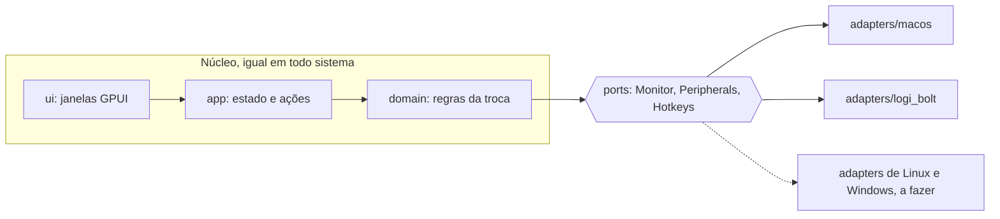

# kvm-switch

App em Rust + GPUI que troca, por atalho, a entrada do monitor e o canal dos periféricos Logitech entre computadores.

- **Destinos:** um por entrada do monitor (USB-C, DP, HDMI). Cada um tem nome, ícone, canal Logitech e atalho próprio.
- **Seletor estilo ⌘Tab:** um atalho abre um painel no centro da tela. Com os modificadores pressionados, cada toque na tecla avança (com Shift, volta). Soltar confirma e troca. Um toque rápido alterna para o destino vizinho.
- **Configuração:** a janela lista as entradas que o monitor informa e deixa editar tudo. Cada mudança é salva na hora.

Hoje só o macOS tem adapter. A pasta [`macos/`](macos/README.md) guarda a versão anterior, em script + Hammerspoon, que continua funcionando de forma independente.

## Rodar

Requisitos no macOS (Apple Silicon): Rust, `m1ddc`, `hidapitester` e, para detectar as entradas, o Dell Display and Peripheral Manager instalado.

```sh
brew install m1ddc hidapitester
cargo run --release
```

Não precisa do Xcode completo: os shaders são compilados quando o app abre.

Fechar a janela não encerra o app, que precisa continuar rodando para ouvir os atalhos. Clicar no ícone do Dock abre a configuração de novo; ⌘Q encerra.

## Usar

1. Na primeira abertura o app lê as entradas do monitor e cria um destino para cada uma. **Detectar entradas** repete a leitura.
2. Em cada linha:
   - **Ícone:** clique para passar ao próximo.
   - **Nome:** clique, digite, Enter.
   - **Onde o app roda:** marque a entrada em que este computador está ligado. O app usa isso para saber quando o destino pedido é o próprio computador.
   - **Canal Logitech:** canal Easy-Switch para onde teclado e mouse vão junto com a tela. `–` não mexe neles.
   - **Atalho:** clique e pressione a combinação. Precisa de Ctrl, Alt ou ⌘. Backspace remove, Esc cancela.
   - **Ir:** troca agora, sem atalho.
3. **Atalho do seletor:** a combinação que abre o painel central.

Se o sistema recusar um atalho (já em uso por outro app, por exemplo), o motivo aparece em vermelho na janela.

### O que acontece numa troca

- **Destino remoto:** o monitor troca de entrada e, se deu certo, teclado e mouse vão para o canal do destino. Se o monitor falhar, os periféricos ficam onde estão.
- **Destino é este computador:** se a tela já está nele, aparece o aviso "Você já está em …". Se a tela ficou em outra entrada, só ela volta.

### Configuração em disco

`~/Library/Application Support/kvm-switch/config.json`. `input` é o valor do código VCP 0x60 do monitor, em decimal (27 = USB-C, 15 = DP, 17 = HDMI num Dell P3225QE).

Um arquivo inválido é renomeado para `config.json.invalido` em vez de ser sobrescrito.

## Arquitetura: portas e adapters



| Módulo | Papel |
|---|---|
| `src/domain.rs` | Regras sem sistema operacional: destinos, canais, ordem da troca, seleção do seletor |
| `src/ports.rs` | As interfaces que cada sistema precisa fornecer |
| `src/adapters.rs` | Escolhe os adapters do sistema em que o app foi compilado |
| `src/adapters/macos.rs` | `Monitor` com `m1ddc` (trocar e ler) e DDPM (listar entradas); `Hotkeys` com `global-hotkey` |
| `src/adapters/logi_bolt.rs` | `Peripherals` pelo receptor Logi Bolt, com `hidapitester` |
| `src/app.rs` | Estado do app: configuração, registro de atalhos, seletor, avisos |
| `src/ui/` | Janela de configuração e painéis centrais |
| `src/config.rs` | Leitura e gravação do JSON |

As três portas:

| Porta | O que o núcleo pede |
|---|---|
| `Monitor` | Listar as entradas, ler a entrada atual, trocar de entrada |
| `Peripherals` | Mandar teclado e mouse para um canal |
| `Hotkeys` | Registrar atalhos globais, entregar cada um como ação, dizer se os modificadores de um atalho ainda estão pressionados |

Os adapters do macOS usam os mesmos comandos de [`macos/kvm-switch.sh`](macos/kvm-switch.sh): `m1ddc set input` para o monitor e HID++ (`setCurrentHost` da feature `0x1814`) pelo `hidapitester` para os periféricos.

### Adicionar um sistema

1. Crie `src/adapters/<sistema>.rs` implementando `Monitor` e `Hotkeys`. O `logi_bolt` não tem nada de macOS e deve servir como está para `Peripherals`.
2. Em `src/adapters.rs`, adicione a função `platform` do sistema com `#[cfg(target_os = "...")]`.
3. Mova as dependências específicas para a seção `target` correspondente do `Cargo.toml`.

Para Linux com Wayland, o `global-hotkey` não funciona: o adapter de `Hotkeys` precisa usar o portal `GlobalShortcuts` do XDG. O monitor sai pelo `ddcutil`.

## Testes

```sh
cargo test
```

Cobrem as regras da troca (com monitor e periféricos de mentira), os parsers das saídas reais de `m1ddc`, DDPM e `hidapitester`, a gravação da configuração e a edição de nome e atalhos na janela.

## Limites conhecidos

- O campo de nome só aceita digitar e apagar no fim: sem cursor, seleção ou acentos compostos.
- O seletor não tem tecla de cancelar. Para desistir, avance até o destino marcado como "aqui" e solte.
- O app não inicia sozinho no login e não tem ícone na barra de menus.
- A busca dos periféricos no receptor leva cerca de 2 s: a tela troca na hora e teclado e mouse seguem depois.
