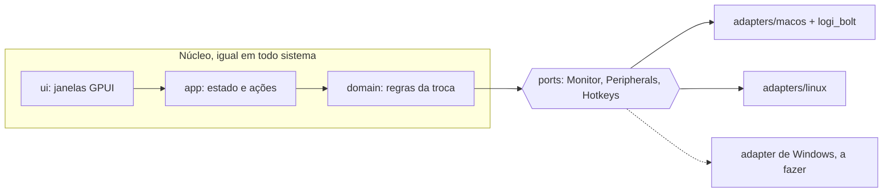

# kvm-switch

App em Rust + GPUI que troca, por atalho, a entrada do monitor e o canal dos periféricos Logitech entre computadores.

- **Destinos:** um por entrada do monitor (USB-C, DP, HDMI). Cada um tem nome, ícone, canal Logitech e atalho próprio.
- **Seletor estilo ⌘Tab:** um atalho abre um painel no centro da tela. Com os modificadores pressionados, cada toque na tecla avança (com Shift, volta). Soltar confirma e troca. Um toque rápido alterna para o destino vizinho.
- **Configuração:** a janela lista as entradas que o monitor informa e deixa editar tudo. Cada mudança é salva na hora.

Roda no macOS e no Linux (GNOME). As pastas [`macos/`](macos/README.md) e [`linux/`](linux/README.md) guardam a versão anterior, em script, que continua funcionando de forma independente, e os instaladores de cada sistema.

## Rodar

### macOS

Requisitos (Apple Silicon): Rust, `m1ddc`, `hidapitester` e, para detectar as entradas, o Dell Display and Peripheral Manager instalado.

```sh
brew install m1ddc hidapitester
cargo run --release
```

Não precisa do Xcode completo: os shaders são compilados quando o app abre.

Fechar a janela não encerra o app, que precisa continuar rodando para ouvir os atalhos. Clicar no ícone do Dock abre a configuração de novo; ⌘Q encerra.

### Linux

Ubuntu ou Debian com GNOME. O instalador traz as dependências, compila, instala em `~/.local/bin/kvm-switch`, cria o ícone "KVM Switch" no menu de aplicativos e abre a janela:

```sh
linux/install.sh --app
```

| Dependência | Para quê |
|---|---|
| `ddcutil` | Falar DDC/CI com o monitor |
| `solaar` | Liberar o receptor Logitech para o usuário (regra udev) e diagnosticar os periféricos |
| `libglib2.0-bin` | `gsettings`, que grava os atalhos no GNOME |
| Rust e bibliotecas de desenvolvimento do xkbcommon, xcb, Wayland e fontconfig | Compilar o GPUI |

O instalador remove os atalhos Super+Alt+1/2/3/0 da versão em script, se existirem: enquanto estão lá, o GNOME não entrega essas teclas ao app.

No Linux o app não fica aberto esperando atalhos:

- Cada atalho é um atalho personalizado do GNOME que roda `kvm-switch` com o pedido. Eles continuam valendo com o app fechado e aparecem em Configurações → Teclado → Atalhos personalizados.
- Uma troca direta roda sem abrir janela, em cerca de 0,25 s. O seletor e os avisos abrem o app na hora, o que leva cerca de 0,5 s.
- O app encerra quando a última janela fecha (é assim que o GPUI funciona no Linux). Abrir "KVM Switch" de novo mostra a configuração; Ctrl+Q encerra.

Pela linha de comando, com o app aberto ou fechado:

```sh
kvm-switch                    # abre a configuração
kvm-switch switch 27          # vai para a entrada 27 (o valor de `input` no config.json)
kvm-switch switcher-next      # abre o seletor ou avança nele
kvm-switch switcher-previous
```

## Usar

1. Na primeira abertura o app lê as entradas do monitor e cria um destino para cada uma, já com um canal Logitech: 1, 2 e 3 na ordem em que o monitor lista as entradas (USB-C, DP e HDMI num Dell P3225QE). **Detectar entradas** repete a leitura.
2. Em cada linha:
   - **Ícone:** clique para passar ao próximo.
   - **Nome:** clique, digite, Enter.
   - **Onde o app roda:** marque a entrada em que este computador está ligado. O app usa isso para saber quando o destino pedido é o próprio computador.
   - **Canal Logitech:** canal Easy-Switch para onde teclado e mouse vão junto com a tela. Clique em 1, 2 ou 3 para trocar; `–` não mexe neles.
   - **Atalho:** clique e pressione a combinação. Precisa de Ctrl, Alt ou ⌘ (Super no Linux). Backspace remove, Esc cancela.
   - **Ir:** troca agora, sem atalho.
3. **Atalho do seletor:** a combinação que abre o painel central.

Se o sistema recusar um atalho (já em uso por outro app, por exemplo), o motivo aparece em vermelho na janela. No GNOME isso vale para os atalhos personalizados de outros programas; uma combinação que o próprio GNOME usa (Super+Alt+←, por exemplo) nem chega à janela para ser gravada.

### O que acontece numa troca

- **Destino remoto:** o monitor troca de entrada e, se deu certo, teclado e mouse vão para o canal do destino. Se o monitor falhar, os periféricos ficam onde estão.
- **Destino é este computador:** se a tela já está nele, aparece o aviso "Você já está em …". Se a tela ficou em outra entrada, só ela volta.

### Configuração em disco

`~/Library/Application Support/kvm-switch/config.json` no macOS e `~/.config/kvm-switch/config.json` no Linux. `input` é o valor do código VCP 0x60 do monitor, em decimal (27 = USB-C, 15 = DP, 17 = HDMI num Dell P3225QE).

Um arquivo inválido é renomeado para `config.json.invalido` em vez de ser sobrescrito.

## Arquitetura: portas e adapters



| Módulo | Papel |
|---|---|
| `src/domain.rs` | Regras sem sistema operacional: destinos, canais, ordem da troca, seleção do seletor |
| `src/ports.rs` | As interfaces que cada sistema precisa fornecer |
| `src/adapters.rs` | Escolhe os adapters do sistema em que o app foi compilado |
| `src/adapters/mccs.rs` | Lê as entradas na capability string do monitor, igual nos dois sistemas |
| `src/adapters/macos.rs` | `Monitor` com `m1ddc` (trocar e ler) e DDPM (listar entradas); `Hotkeys` com `global-hotkey` |
| `src/adapters/logi_bolt.rs` | macOS: `Peripherals` pelo receptor Logi Bolt, com `hidapitester` |
| `src/adapters/linux.rs` | `Monitor` com `ddcutil` |
| `src/adapters/linux/hidraw.rs` | `Peripherals` pelo receptor Logitech, direto no `hidraw` |
| `src/adapters/linux/gnome.rs` | `Hotkeys` pelos atalhos personalizados do GNOME |
| `src/adapters/linux/instance.rs` | Linha de comando e entrega do pedido ao app já aberto, por um socket |
| `src/app.rs` | Estado do app: configuração, registro de atalhos, seletor, avisos |
| `src/ui/` | Janela de configuração e painéis centrais |
| `src/config.rs` | Leitura e gravação do JSON |

As três portas:

| Porta | O que o núcleo pede |
|---|---|
| `Monitor` | Listar as entradas, ler a entrada atual, trocar de entrada |
| `Peripherals` | Mandar teclado e mouse para um canal |
| `Hotkeys` | Registrar atalhos globais, entregar cada um como ação, dizer se os modificadores de um atalho ainda estão pressionados (ou que o sistema não deixa saber) |

Os adapters do macOS usam os mesmos comandos de [`macos/kvm-switch.sh`](macos/kvm-switch.sh): `m1ddc set input` para o monitor e HID++ (`setCurrentHost` da feature `0x1814`) pelo `hidapitester` para os periféricos.

### Como o Linux atende cada porta

- **`Monitor`:** `ddcutil` no barramento I2C do monitor, com `--bus` e `--skip-ddc-checks`. O número do barramento fica em `~/.cache/kvm-switch/ddc-bus`; sem ele o `ddcutil` procura o monitor a cada chamada, o que leva cerca de 1,5 s.
- **`Peripherals`:** os mesmos pacotes HID++ do macOS, escritos direto no `hidraw` do receptor, um slot por thread. Leva cerca de 0,07 s com os periféricos acordados e até 1 s se algum estiver em repouso. O `solaar config … change-host` faz o mesmo em cerca de 2,7 s por dispositivo, por isso o Solaar entra só com a regra udev.
- **`Hotkeys`:** no Wayland um app não ouve o teclado fora da própria janela, então o `global-hotkey` não serve. O portal `GlobalShortcuts` do XDG existe no GNOME, mas pede uma confirmação do sistema a cada atalho novo e deixa a troca de tecla para as Configurações, o que não combina com gravar o atalho na janela do app. O adapter grava atalhos personalizados do GNOME que rodam `kvm-switch <pedido>`; a nova execução entrega o pedido ao app aberto por um socket em `$XDG_RUNTIME_DIR` e sai.
- **Modificadores do seletor:** o Wayland só mostra o teclado à janela em foco. O seletor recebe o foco ao abrir e é ele quem diz ao app quando os modificadores foram soltos. Se a janela não receber o foco, o seletor confirma após 1,2 s sem toques.

Fora do GNOME o app funciona, mas não cria os atalhos: crie-os no seu ambiente gráfico apontando para os comandos acima.

O `Cargo.toml` aponta a `xattr` para `vendor/xattr`: o GPUI 0.2.2 depende da versão 0.2.3, que não compila no Linux com a `libc` atual. A cópia tem uma constante corrigida e mais nada.

### Adicionar um sistema

1. Crie `src/adapters/<sistema>.rs` implementando `Monitor`, `Peripherals` e `Hotkeys`.
2. Em `src/adapters.rs`, adicione as funções `devices`, `hotkeys` e `first_action` do sistema com `#[cfg(target_os = "...")]`.
3. Mova as dependências específicas para a seção `target` correspondente do `Cargo.toml`.

## Testes

```sh
cargo test
```

Cobrem as regras da troca (com monitor e periféricos de mentira), os parsers das saídas reais de `m1ddc`, DDPM, `hidapitester`, `ddcutil`, `gsettings` e do receptor Logitech, a conversão dos atalhos para o GNOME, a gravação da configuração e a edição de nome e atalhos na janela. Os testes de cada adapter só rodam no sistema dele.

## Limites conhecidos

- O campo de nome só aceita digitar e apagar no fim: sem cursor, seleção ou acentos compostos.
- O seletor não tem tecla de cancelar. Para desistir, avance até o destino marcado como "aqui" e solte.
- O app não inicia sozinho no login e não tem ícone na barra de menus. No Linux isso não faz falta: os atalhos funcionam com ele fechado.
- No macOS a busca dos periféricos no receptor leva cerca de 2 s: a tela troca na hora e teclado e mouse seguem depois.
- No Linux o seletor e os avisos são janelas comuns do Wayland: recebem o foco enquanto estão abertos e é o GNOME que escolhe onde ficam na tela.
- No Linux os atalhos só são criados sozinhos no GNOME, e o monitor usado é o primeiro que responde por DDC/CI.
