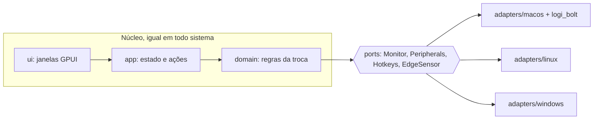

# kvm-switch

App em Rust + GPUI que troca, por atalho, a entrada do monitor e o canal dos periféricos Logitech entre computadores, e passa teclado e mouse para o PC do lado quando o cursor encosta na borda da tela.

- **Destinos:** um por entrada do monitor (USB-C, DP, HDMI). Cada um tem nome, ícone, canal Logitech e atalho próprio.
- **Seletor estilo ⌘Tab:** um atalho abre um painel no centro da tela. Com os modificadores pressionados, cada toque na tecla avança (com Shift, volta). Soltar confirma e troca. Um toque rápido alterna para o destino vizinho.
- **Bordas:** cada PC diz qual vizinho fica à esquerda, à direita, em cima e embaixo. Levar o cursor até aquela borda manda teclado e mouse para o canal Logitech do vizinho, como no Logitech Flow, mas sem rede: cada PC roda o app e o do outro lado devolve. A borda nunca troca a entrada do monitor.
- **Configuração:** a janela lista as entradas que o monitor informa e deixa editar tudo. Cada mudança é salva na hora.

Roda no macOS, Linux (GNOME) e Windows. As pastas [`macos/`](macos/README.md) e [`linux/`](linux/README.md) guardam a versão anterior, em script, que continua funcionando de forma independente, e os instaladores desses sistemas.

## Rodar

### macOS

Requisitos (Apple Silicon): Rust, `m1ddc`, `hidapitester` e, para detectar as entradas, o Dell Display and Peripheral Manager instalado.

```sh
brew install m1ddc hidapitester
cargo run --release
```

Não precisa do Xcode completo: os shaders são compilados quando o app abre.

Fechar a janela não encerra o app, que precisa continuar rodando para ouvir os atalhos e vigiar as bordas. Clicar no ícone do Dock abre a configuração de novo; ⌘Q pergunta antes de encerrar. O ícone 🖥 na barra de menus tem o mesmo menu do Linux (veja [Usar](#usar)).

#### Instalador (.app e .dmg)

```sh
macos/bundle.sh
```

Gera `target/release/KVM Switch.app` e `target/release/KVM-Switch-<versão>.dmg`. Abra o `.dmg` e arraste o app para Aplicativos. Só usa o `cargo` e ferramentas que já vêm no macOS (`sips`, `iconutil`, `codesign`, `hdiutil`).

- O app continua precisando de `brew install m1ddc hidapitester` (e do DDPM para detectar as entradas) em cada Mac onde for instalado.
- A assinatura é ad hoc, sem conta de desenvolvedor da Apple. Na máquina que gerou o `.dmg` ele abre direto. Em outro Mac o Gatekeeper barra o app baixado: libere em Ajustes → Privacidade e Segurança → "Abrir mesmo assim", ou rode `xattr -dr com.apple.quarantine "/Applications/KVM Switch.app"`.
- Pela linha de comando, o executável fica em `"/Applications/KVM Switch.app/Contents/MacOS/kvm-switch"`.
- **Abre no login, sem janela** (só o ícone na barra), para as bordas valerem desde o início da sessão. O app se registra na primeira vez que abre de `/Applications` ou `~/Applications`, com um LaunchAgent em `~/Library/LaunchAgents/io.github.mpgxc.kvm-switch.plist` que roda `open -g -a "KVM Switch" --args start`. Para desligar, use Ajustes → Geral → Itens de Início; apagar o arquivo não basta, porque o app o grava de novo ao abrir.

### Linux

Ubuntu (24.04 ou mais novo) ou Debian com GNOME; as bordas precisam do GNOME Shell 45 ou mais novo. O instalador traz as dependências, compila, instala em `~/.local/bin/kvm-switch`, cria o ícone "KVM Switch" no menu de aplicativos, põe o ícone na barra superior (e o abre a cada login), instala e liga a extensão das bordas e abre a janela:

```sh
linux/install.sh --app
```

| Dependência | Para quê |
|---|---|
| `ddcutil` | Falar DDC/CI com o monitor |
| `solaar` | Liberar o receptor Logitech para o usuário (regra udev) e diagnosticar os periféricos |
| `libglib2.0-bin` | `gsettings`, que grava os atalhos no GNOME |
| Rust e bibliotecas de desenvolvimento do xkbcommon, xcb, Wayland e fontconfig | Compilar o GPUI |

Nenhum pacote a mais para o ícone na barra: ele fala com o GNOME por D-Bus. O GNOME só o mostra com a extensão de AppIndicator ativa, que o Ubuntu já traz (`ubuntu-appindicators@ubuntu.com`); em outras distribuições instale "AppIndicator and KStatusNotifierItem Support". O instalador avisa se ela não estiver ativa.

O instalador remove os atalhos Super+Alt+1/2/3/0 da versão em script, se existirem: enquanto estão lá, o GNOME não entrega essas teclas ao app.

A extensão das bordas (`kvm-switch@mpgxc.github.io`, em [`linux/gnome-extension/`](linux/gnome-extension)) vai para `~/.local/share/gnome-shell/extensions/`. No Wayland o GNOME só carrega uma extensão nova, ou uma atualização dela, depois de sair e entrar na sessão; o instalador e a janela avisam. Ela não lê a configuração: só roda `kvm-switch edge <lado>`, e quem decide se aquele lado tem vizinho é o app.

No Linux o app não fica aberto esperando atalhos:

- Cada atalho é um atalho personalizado do GNOME que roda `kvm-switch` com o pedido. Eles continuam valendo com o app fechado e aparecem em Configurações → Teclado → Atalhos personalizados.
- Uma troca direta roda sem abrir janela, em cerca de 0,25 s. O seletor e os avisos abrem o app na hora, o que leva cerca de 0,5 s.
- O app encerra quando a última janela fecha (é assim que o GPUI funciona no Linux). Abrir "KVM Switch" com ele já aberto pergunta se é para encerrar o aberto e abrir de novo (veja [Um app por vez](#um-app-por-vez)); Ctrl+Q pergunta antes de encerrar.
- O ícone na barra é um processo à parte e pequeno, `kvm-switch tray`, que nunca abre janela: cada item do menu roda `kvm-switch` com o pedido, como um atalho. O menu acompanha o `config.json` (confere a cada 2 s). Só um ícone por sessão; ele abre sozinho no login por `~/.config/autostart/kvm-switch-tray.desktop`.

Pela linha de comando, com o app aberto ou fechado:

```sh
kvm-switch                    # abre a configuração
kvm-switch switch 27          # vai para a entrada 27 (o valor de `input` no config.json)
kvm-switch edge direita       # manda teclado e mouse para o vizinho da direita (esquerda, direita, cima, baixo)
kvm-switch switcher-next      # abre o seletor ou avança nele
kvm-switch switcher-previous
kvm-switch quit               # pergunta e, com o sim, encerra o app aberto (sai com 2 se a resposta for não)
kvm-switch tray               # põe o ícone na barra (só no Linux)
```

#### Pacote .deb

```sh
linux/deb.sh
```

Gera `target/release/kvm-switch_<versão>_<arquitetura>.deb`, com as mesmas dependências de compilação do `install.sh --app`. Instale com `sudo apt install ./kvm-switch_*.deb`: o apt traz `ddcutil`, `libglib2.0-bin`, Vulkan e as bibliotecas do GPUI, e recomenda o `solaar`. O pacote põe o binário em `/usr/bin/kvm-switch`, o atalho no menu, o ícone na barra a cada login (`/etc/xdg/autostart`) e a extensão das bordas em `/usr/share/gnome-shell/extensions/`, para todos os usuários. Cada usuário liga a extensão ao ligar as Bordas na janela. Diferente do `install.sh`, não remove os atalhos da versão em script nem abre o app.

### Windows

Requer Windows 10 ou posterior, Rust e as ferramentas de compilação C++ do Visual Studio (workload **Desenvolvimento para desktop com C++**) para compilar. O app usa DDC/CI nativo do Windows e HIDAPI nativo para o receptor Bolt; não precisa instalar `ddcutil`, `hidapitester` ou outra ferramenta à parte. Deixe DDC/CI ligado no menu do monitor e conecte o receptor Bolt ao computador.

```powershell
cargo run --release
```

O executável fica em `target\release\kvm-switch.exe`. No Windows, fechar a janela pelo X a minimiza e mantém o app, os atalhos e as bordas ativos; use **Abrir configuração** no menu do ícone da área de notificação para restaurá-la. Clique com o botão direito no ícone para escolher um destino ou encerrar. A tecla Windows é representada como `Super` ao gravar os atalhos. `kvm-switch.exe start` abre o app sem janela, só com o ícone.

#### Instalador do Windows

Instale o [Inno Setup](https://jrsoftware.org/isinfo.php) e gere o instalador pelo PowerShell, na raiz do projeto:

```powershell
.\windows\build-installer.ps1
```

O script compila a versão release e gera `target\release\KVM-Switch-Setup-<versão>.exe`. O instalador coloca o app em `%LOCALAPPDATA%\Programs\KVM Switch`, cria um atalho no menu Iniciar e oferece iniciar com o Windows (marcado por padrão), minimizado na área de notificação. Também é possível criar um atalho na área de trabalho. O menu do ícone permite abrir a configuração, trocar de destino ou encerrar o app.

O workflow de release gera e publica o instalador junto com o executável avulso.

### Releases

Cada tag `v*` enviada ao GitHub dispara `.github/workflows/release.yml`, que gera o `.dmg` (macOS, Apple Silicon), o `.deb` (Ubuntu 24.04, amd64) e o executável `.exe` (Windows x64) e publica os três numa release. Em cada pull request e pelo botão **Run workflow** da aba Actions o mesmo workflow só gera os builds, sem publicar, para conferir antes da tag. O `release.sh` faz a tag:

```sh
./release.sh 0.2.0   # põe 0.2.0 no Cargo.toml e no Cargo.lock, commita, cria a tag v0.2.0 e envia
./release.sh         # publica a versão que já está no Cargo.toml
```

Ele só roda na `main` limpa e igual à `origin/main`, e recusa uma tag que já existe.

## Usar

1. Na primeira abertura o app lê as entradas do monitor e cria um destino para cada uma, já com um canal Logitech: 1, 2 e 3 na ordem em que o monitor lista as entradas (USB-C, DP e HDMI num Dell P3225QE). **Detectar entradas** repete a leitura.
2. **Modos**, dois interruptores independentes, que podem ficar ligados juntos:
   - **Monitor compartilhado (atalhos e seletor):** tudo o que troca a tela e os periféricos juntos: atalhos, seletor, **Ir** e os itens "Ir para …" do ícone na barra. Desligado, os atalhos saem do sistema, o seletor não abre, o **Ir** fica inativo e um `kvm-switch switch N` só mostra o aviso "O modo Monitor compartilhado está desligado". A lista continua editável. Já vem ligado, inclusive num `config.json` antigo.
   - **Bordas (só teclado e mouse):** a troca pela borda (veja [Bordas](#bordas)). Já vem desligado.
3. Em cada linha:
   - **Ativo:** desmarcado, o destino sai do seletor: não aparece no painel e o ciclo pula ele. A linha fica apagada, mas continua editável, e o atalho próprio e o **Ir** dele seguem funcionando. Todo destino nasce ativo, inclusive os de um `config.json` antigo.
   - **Ícone:** clique para passar ao próximo: 🖥 💻 🍎 🐧 🪟 🎮. O destino deste computador já nasce com o ícone do sistema (🍎 no macOS, 🐧 no Linux, 🪟 no Windows); os outros, com 🖥.
   - **Nome:** clique, digite, Enter.
   - **Onde o app roda:** marque a entrada em que este computador está ligado. O app usa isso para saber quando o destino pedido é o próprio computador.
   - **Canal Logitech:** canal Easy-Switch para onde teclado e mouse vão junto com a tela. Clique em 1, 2 ou 3 para trocar; `–` não mexe neles.
   - **Atalho:** clique e pressione a combinação. Precisa de Ctrl, Alt ou ⌘ (Super no Linux e tecla Windows no Windows). Backspace remove, Esc cancela.
   - **Ir:** troca agora, sem atalho.
4. **Atalho do seletor:** a combinação que abre o painel central, só com os destinos ativos. Sem nenhum ativo, ele não abre.
5. **Ícone na barra** (🖥, na barra superior do GNOME, na barra de menus do macOS ou na área de notificação do Windows): **Abrir configuração**, um **Ir para …** por destino ativo (o deste computador marcado "aqui"; só com o modo Monitor compartilhado ligado) e **Encerrar**, que pergunta antes e, com o sim, fecha o app e o ícone. No GNOME o clique simples abre o menu e o duplo abre a configuração.

Se o sistema recusar um atalho (já em uso por outro app, por exemplo), o motivo aparece em vermelho na janela. No GNOME isso vale para os atalhos personalizados de outros programas; uma combinação que o próprio GNOME usa (Super+Alt+←, por exemplo) nem chega à janela para ser gravada.

### Um app por vez

Só um KVM Switch roda por sessão, em todos os sistemas: dois vigiando a mesma borda trocariam o canal duas vezes. O app aberto atende as outras execuções do programa por um socket do usuário (Linux e macOS) ou por um named pipe (Windows).

- **Abrir o app com ele já aberto** (ícone, menu Iniciar ou Aplicativos, `kvm-switch` sem argumentos) pergunta "O KVM Switch já está aberto": **Encerrar e abrir de novo** encerra o aberto sem perguntar mais nada e abre este no lugar; **Mostrar o aberto** (ou Esc) só traz a janela do aberto. No macOS, abrir pelo Dock ou pelo Finder com o app aberto só mostra a janela, porque o próprio sistema não inicia outra cópia; a pergunta aparece quando o executável roda direto.
- **Atalhos, bordas e pedidos da linha de comando** (`switch`, `edge`, `switcher-next`, `start`…) vão direto para o app aberto, sem perguntar.
- **Encerrar** pergunta antes: ⌘Q ou Ctrl+Q, **Encerrar** no ícone da barra e `kvm-switch quit`. Enter confirma e Esc cancela. No Linux, se a resposta for não, o ícone da barra continua lá.

### O que acontece numa troca

- **Destino remoto:** o monitor troca de entrada e, se deu certo, teclado e mouse vão para o canal do destino. Se o monitor falhar, os periféricos ficam onde estão.
- **Destino é este computador:** se a tela já está nele, aparece o aviso "Você já está em …". Se a tela ficou em outra entrada, só ela volta.
- **Borda:** só teclado e mouse vão para o canal do vizinho; a tela não muda. Sem aviso quando dá certo; um erro aparece como aviso.

### Bordas

Para PCs lado a lado, cada um com a própria tela. Todos rodam o app e cada um configura só os próprios vizinhos; eles não se falam pela rede.

- **Quadro 3×3:** "Este PC" no centro e um espaço por lado. Em cada lado, o **canal Logitech** do vizinho (clique: `–`, 1, 2, 3) e um **nome** opcional, só para lembrar quem está ali. Lado com `–` não troca nada.
- **Exemplo:** o Mac usa o canal 1 e o Linux, à direita dele, o canal 2. No Mac, a direita recebe o canal 2; no Linux, a esquerda recebe o canal 1.
- **Só as bordas externas contam:** com dois monitores no mesmo PC, o cursor passa de um para o outro normalmente. Os cantos (8 pontos de cada lado) não disparam, para não brigar com os cantos ativos do sistema.
- **Sem vai-e-volta:** quando teclado e mouse voltam, o cursor do PC ainda está parado na borda por onde saiu; ela só passa a valer de novo depois que o cursor sai dela. Entre duas travessias há uma pausa de 1 s.
- **O cursor não leva a altura:** sair pela metade de baixo da borda não põe o cursor na metade de baixo do outro PC. Exigiria rede.
- **macOS e Windows:** o app consulta a posição do cursor e das telas a cada 20 ms, sem pedir permissão. A troca é imediata no primeiro toque na borda, então um vizinho em cima ou embaixo dispara ao encostar na barra de menus ou no Dock do macOS, e um vizinho embaixo dispara ao encostar na barra de tarefas do Windows; a janela avisa ao lado desses espaços.
- **Linux (GNOME 45 ou mais novo):** o Wayland não deixa um app ver o cursor fora da própria janela. Uma extensão do GNOME Shell põe barreiras de pressão nas bordas externas (as mesmas dos cantos ativos) e, quando o cursor empurra uma delas, roda `kvm-switch edge <lado>`; o app decide se aquele lado tem vizinho. Como é preciso empurrar, encostar não dispara.

### Configuração em disco

`~/Library/Application Support/kvm-switch/config.json` no macOS, `~/.config/kvm-switch/config.json` no Linux e `%APPDATA%\kvm-switch\config.json` no Windows. `input` é o valor do código VCP 0x60 do monitor, em decimal (27 = USB-C, 15 = DP, 17 = HDMI num Dell P3225QE). `monitor_mode` é o modo Monitor compartilhado; `edges` guarda o modo Bordas (`enabled`) e, em `left`, `right`, `top` e `bottom`, o `channel` e o `name` de cada vizinho.

Um arquivo inválido é renomeado para `config.json.invalido` em vez de ser sobrescrito.

## Arquitetura: portas e adapters



| Módulo | Papel |
|---|---|
| `src/domain.rs` | Regras sem sistema operacional: destinos, canais, ordem da troca, seleção do seletor, vizinhos das bordas, borda externa e armar/desarmar |
| `src/ports.rs` | As interfaces que cada sistema precisa fornecer |
| `src/adapters.rs` | Escolhe os adapters do sistema em que o app foi compilado |
| `src/adapters/mccs.rs` | Lê as entradas na capability string do monitor |
| `src/adapters/cursor.rs` | `EdgeSensor` do macOS e do Windows: uma thread lê o cursor e as telas a cada 20 ms e passa às regras das bordas |
| `src/adapters/macos.rs` | `Monitor` com `m1ddc` (trocar e ler) e DDPM (listar entradas); `Hotkeys` com `global-hotkey`; `StatusMenu` com `tray-icon`; o cursor e as telas pelo Quartz; o item de login |
| `src/adapters/logi_bolt.rs` | macOS: `Peripherals` pelo receptor Logi Bolt, com `hidapitester`, guardando o slot de cada periférico para as trocas seguintes |
| `src/adapters/linux.rs` | `Monitor` com `ddcutil` |
| `src/adapters/linux/hidraw.rs` | `Peripherals` pelo receptor Logitech, direto no `hidraw` |
| `src/adapters/linux/gnome.rs` | `Hotkeys` pelos atalhos personalizados do GNOME |
| `src/adapters/linux/edges.rs` | `EdgeSensor`: liga a extensão do GNOME e diz à janela se ela ainda não está ativa |
| `linux/gnome-extension/` | A extensão do GNOME Shell (45+) com as barreiras de pressão nas bordas externas, que roda `kvm-switch edge <lado>` |
| `src/adapters/instance.rs` | Um app por sessão: decide se a execução vira o app, entrega o pedido ao aberto ou pergunta; o transporte é `instance/socket.rs` (socket Unix no Linux e no macOS) ou `instance/pipe.rs` (named pipe no Windows) |
| `src/adapters/linux/tray.rs` | `kvm-switch tray`: o ícone na barra, num processo à parte e sem GPUI |
| `src/adapters/windows.rs` | `Monitor` por DDC/CI, `Peripherals` por HIDAPI, atalhos globais, ícone na área de notificação e o cursor e os monitores pelo Win32 |
| `src/request.rs` | Os pedidos em texto (`open`, `switch 27`, `edge direita`, `quit`…), iguais na linha de comando, no socket ou pipe, no menu do ícone e na extensão do GNOME |
| `src/tray.rs` | O menu do ícone na barra, montado da configuração |
| `src/app.rs` | Estado do app: configuração, registro de atalhos, seletor, travessias pela borda, avisos |
| `src/ui/` | Janela de configuração e painéis centrais (seletor, avisos e perguntas) |
| `src/config.rs` | Leitura e gravação do JSON |

As portas:

| Porta | O que o núcleo pede |
|---|---|
| `Monitor` | Listar as entradas, ler a entrada atual, trocar de entrada |
| `Peripherals` | Mandar teclado e mouse para um canal |
| `Hotkeys` | Registrar atalhos globais, entregar cada um como ação, dizer se os modificadores de um atalho ainda estão pressionados (ou que o sistema não deixa saber) |
| `EdgeSensor` | Vigiar os lados com vizinho e entregar cada travessia como ação (ou, no GNOME, deixar a extensão rodar `kvm-switch edge`), dizendo à janela se as bordas ainda não funcionam |
| `StatusMenu` | Mostrar o ícone na barra com o menu montado da configuração e entregar cada item clicado como ação. Opcional: o Linux não tem um no processo do app |

Os adapters do macOS usam os mesmos comandos de [`macos/kvm-switch.sh`](macos/kvm-switch.sh): `m1ddc set input` para o monitor e HID++ (`setCurrentHost` da feature `0x1814`) pelo `hidapitester` para os periféricos. O Windows usa as APIs nativas DDC/CI e HID; não requer ferramentas externas.

### Como o Linux atende cada porta

- **`Monitor`:** `ddcutil` no barramento I2C do monitor, com `--bus` e `--skip-ddc-checks`. O número do barramento fica em `~/.cache/kvm-switch/ddc-bus`; sem ele o `ddcutil` procura o monitor a cada chamada, o que leva cerca de 1,5 s.
- **`Peripherals`:** os mesmos pacotes HID++ do macOS, escritos direto no `hidraw` do receptor, um slot por thread. Leva cerca de 0,07 s com os periféricos acordados e até 1 s se algum estiver em repouso. O `solaar config … change-host` faz o mesmo em cerca de 2,7 s por dispositivo, por isso o Solaar entra só com a regra udev.
- **`Hotkeys`:** no Wayland um app não ouve o teclado fora da própria janela, então o `global-hotkey` não serve. O portal `GlobalShortcuts` do XDG existe no GNOME, mas pede uma confirmação do sistema a cada atalho novo e deixa a troca de tecla para as Configurações, o que não combina com gravar o atalho na janela do app. O adapter grava atalhos personalizados do GNOME que rodam `kvm-switch <pedido>`; a nova execução entrega o pedido ao app aberto por um socket em `$XDG_RUNTIME_DIR` e sai.
- **`StatusMenu`:** nenhum dentro do app, que encerra com a última janela. O ícone é o `kvm-switch tray`, um StatusNotifierItem por D-Bus (`tray-icon` com `ksni`, sem GTK) que pede cada item rodando `kvm-switch <pedido>`.
- **Modificadores do seletor:** o Wayland só mostra o teclado à janela em foco. O seletor recebe o foco ao abrir e é ele quem diz ao app quando os modificadores foram soltos. Se a janela não receber o foco, o seletor confirma após 1,2 s sem toques.
- **`EdgeSensor`:** o Wayland também esconde o cursor fora da janela do app. A extensão põe uma barreira de pressão em cada trecho de borda externa (sem os 8 pontos dos cantos), com a mesma força dos cantos ativos (cerca de 100 pontos de empurrão em 1 s), refeitas quando os monitores mudam; vale também na visão geral. Cada empurrão roda `kvm-switch edge <lado>`, ignorando novos empurrões enquanto ele roda e por 1 s depois. Com o app fechado, a troca roda sem janela. Ao ligar as Bordas, o app roda `gnome-extensions enable` (ou, se o GNOME ainda não carregou a extensão, a põe em `enabled-extensions`) e confere o estado com `gnome-extensions info`.

Fora do GNOME o app funciona, mas não cria os atalhos: crie-os no seu ambiente gráfico apontando para os comandos acima.

### Como o Windows atende cada porta

- **`Monitor`:** `ddc-hi` usa a Windows Monitor Configuration API para listar os modos de entrada anunciados pela capability string e ler ou alterar o VCP 0x60. É selecionado o primeiro monitor que responde a essa feature.
- **`Peripherals`:** `hidapi` abre a interface HID++ (`FF00:0002`) de cada receptor Bolt e envia os mesmos comandos `getFeature(0x1814)` e `setCurrentHost` usados no macOS/Linux.
- **`Hotkeys`:** `global-hotkey` registra as combinações no loop Win32 do app. A tecla Windows aparece como `Super` na configuração.
- **`StatusMenu`:** `tray-icon` cria o ícone e o menu na área de notificação do Windows, no mesmo processo do app.
- **`EdgeSensor`:** a mesma thread do macOS (`adapters/cursor.rs`), lendo o cursor com `GetCursorPos` e os monitores com `EnumDisplayMonitors`, nas coordenadas da tela virtual. Sem gancho de mouse e sem permissão extra.
- **Abrir com o Windows:** o instalador cria, na pasta Inicializar, um atalho que roda `kvm-switch.exe start`, para as bordas valerem desde o login.

O `Cargo.toml` aponta a `xattr` para `vendor/xattr`: o GPUI 0.2.2 depende da versão 0.2.3, que não compila no Linux com a `libc` atual. A cópia tem uma constante corrigida e mais nada.

### Adicionar um sistema

1. Crie `src/adapters/<sistema>.rs` implementando `Monitor`, `Peripherals`, `Hotkeys` e `EdgeSensor`.
2. Em `src/adapters.rs`, adicione as funções `devices`, `hotkeys`, `edge_sensor` e `first_action` do sistema com `#[cfg(target_os = "...")]`.
3. Mova as dependências específicas para a seção `target` correspondente do `Cargo.toml`.

## Testes

```sh
cargo test
```

Cobrem as regras da troca (com monitor e periféricos de mentira), as bordas (a travessia nunca toca o monitor, borda externa com várias telas, cantos, armar/desarmar), os parsers das saídas reais de `m1ddc`, DDPM, `hidapitester`, `ddcutil`, `gsettings` e dos pacotes do receptor Logitech, a conversão dos atalhos para o GNOME, a gravação da configuração (inclusive arquivos de antes dos modos) e a edição de nome, atalhos, modos e vizinhos na janela. Os testes de cada adapter só rodam no sistema dele.

## Limites conhecidos

- O campo de nome só aceita digitar e apagar no fim: sem cursor, seleção ou acentos compostos.
- O seletor não tem tecla de cancelar. Para desistir, avance até o destino marcado como "aqui" e solte.
- No Linux só o ícone na barra abre no login; os atalhos e as bordas funcionam com o app fechado.
- No macOS o abrir no login não tem interruptor na janela, e só vale com o app instalado em Aplicativos.
- As bordas não passam a posição do cursor nem a área de transferência para o outro PC: não há rede entre eles. A volta depende do app rodando no outro PC.
- No Linux o GPUI não aceita o token de ativação que o GNOME manda no clique do ícone: a janela aberta pelo menu pode não receber o foco.
- No macOS o app procura teclado e mouse no receptor ao abrir (cerca de 1 s, até 2 s com algum em repouso) e guarda em que slot cada um está; as trocas seguintes levam cerca de 0,02 s. Um periférico desligado, em repouso ou em outro PC nessa busca entra depois da troca seguinte. Um slot pareado de novo com outro modelo só é reconhecido depois de reabrir o app.
- No Linux o seletor e os avisos são janelas comuns do Wayland: recebem o foco enquanto estão abertos e é o GNOME que escolhe onde ficam na tela.
- No Linux os atalhos só são criados sozinhos no GNOME, e o monitor usado é o primeiro que responde por DDC/CI.
- No Windows, o DDC/CI depende do suporte do monitor e do driver de vídeo; a busca escolhe o primeiro monitor que responde ao VCP 0x60.
