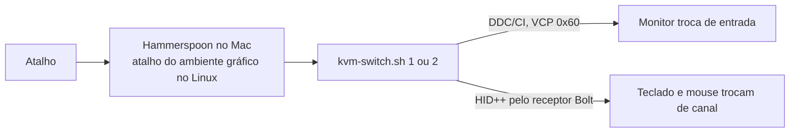

# kvm-switch

Um atalho de teclado troca, de uma vez, a entrada do monitor e o canal Easy-Switch do teclado e do mouse entre dois computadores.

| Atalho | Destino | Entrada do monitor | Canal Logitech |
|---|---|---|---|
| ⌘⌥1 no Mac, Super+Alt+1 no Linux | Mac | USB-C | 1 |
| ⌘⌥2 no Mac, Super+Alt+2 no Linux | Linux | DP | 2 |

No teclado Logitech em layout Windows, ⌘⌥ são as teclas Win+Alt.

Apertar o atalho da máquina em que você já está não troca nada: aparece a notificação "você já está no Mac (USB-C)" (ou Linux/DP).

## Equipamento

- Monitor Dell P3225QE com DDC/CI ligado no menu do monitor. Mac no USB-C, Linux no DisplayPort.
- Logitech MX Mechanical Mini e MX Master 3S.
- Um receptor Logi Bolt em cada máquina. Teclado e mouse pareados no canal 1 com o receptor do Mac e no canal 2 com o receptor do Linux.

## Como funciona



O mesmo `kvm-switch.sh` roda nas duas máquinas. Quem manda teclado e mouse embora é sempre a máquina onde eles estão conectados, então cada lado precisa do script instalado: o Mac executa a ida para o Linux e o Linux executa a volta.

**Monitor.** A entrada é o código VCP `0x60` do DDC/CI. No Mac o comando sai pelo `m1ddc`; no Linux, pelo `ddcutil`.

| Entrada | Valor |
|---|---|
| USB-C | `0x1b` (27) |
| DP | `0x0f` (15) |
| HDMI | `0x11` (17) |

**Teclado e mouse.** O script fala HID++ 2.0 com o receptor Bolt (USB `046d:c548`) usando o `hidapitester`:

1. Percorre os 6 slots de pareamento do receptor.
2. Em cada slot pergunta o índice da feature `0x1814` (Change Host). O índice muda de um dispositivo para outro, por isso é descoberto a cada execução.
3. Para cada dispositivo encontrado envia `setCurrentHost` com o canal de destino (0 = canal 1, 1 = canal 2).

**Ordem.** A troca do monitor roda em paralelo com a busca dos periféricos. O `setCurrentHost` só é enviado depois que o comando do monitor terminou sem erro; se o monitor falhar, teclado e mouse ficam onde estão.

**Destino igual à máquina atual.** O atalho só chega na máquina que está com o teclado, então "destino = esta máquina" significa que você já está nela. O script avisa, não mexe nos periféricos e reenvia a entrada do monitor em segundo plano. Isso serve para trazer a tela de volta quando o teclado voltou pelo botão Easy-Switch mas o monitor ficou em outra entrada.

**Tempo.** No Mac a troca completa leva cerca de 2,5 s: a tela muda quase na hora e teclado e mouse seguem uns 2 s depois, que é o tempo da busca nos slots.

### Códigos de saída do script

| Código | Significado |
|---|---|
| 0 | Trocou monitor e periféricos |
| 1 | Erro: o monitor não trocou ou nenhum periférico Logitech foi achado no receptor |
| 2 | Argumento inválido (use `1` ou `2`) |
| 3 | Você já está na máquina de destino |

A mensagem vai para o stderr. No Mac o Hammerspoon mostra esse texto como notificação do sistema; no Linux o aviso do código 3 sai pelo `notify-send`.

## Arquivos

| Arquivo | Função |
|---|---|
| `install.sh` | Instalador do macOS: baixa as dependências, cria os links e inicia o Hammerspoon |
| `kvm-switch.sh` | O script, igual para Mac e Linux |
| `init.lua` | Configuração do Hammerspoon: registra ⌘⌥1 e ⌘⌥2 e inicia o Hammerspoon no login |
| `70-logi-bolt.rules` | Regra udev do Linux que libera o receptor Bolt sem root |

## Instalação no macOS

Requer Mac com Apple Silicon (exigência do `m1ddc`).

```sh
git clone https://github.com/mpgxc/kvm-switch.git
kvm-switch/macos/install.sh
```

O `install.sh` faz tudo e pode ser rodado de novo sem risco:

1. Instala o Homebrew, se faltar.
2. Instala `m1ddc`, `hidapitester` e o Hammerspoon.
3. Cria em `~/.hammerspoon` os links para `init.lua` e `kvm-switch.sh` desta pasta. Se já existir um arquivo seu com esse nome, ele é renomeado para `<nome>.bak-<data>` antes; nesse caso copie o que precisar do backup para o novo `init.lua`.
4. Reinicia o Hammerspoon para carregar os atalhos.
5. Confere se o monitor e o receptor Bolt respondem e avisa se não.

A pasta clonada precisa continuar no lugar, porque os links apontam para ela.

Permissões:

- **Notificações:** na primeira notificação o macOS pergunta se permite notificações do Hammerspoon. Sem permitir, os avisos não aparecem. Também fica em Ajustes → Notificações → Hammerspoon.
- **Acessibilidade:** se os atalhos não dispararem, libere o Hammerspoon em Ajustes → Privacidade e Segurança → Acessibilidade.

Depois de editar o `init.lua`, use Reload Config no menu do Hammerspoon. Mudanças no `kvm-switch.sh` valem na hora.

## Instalação no Linux

1. Copie esta pasta para a máquina.
2. Instale o `ddcutil` e o `notify-send` (pacote `libnotify`, o nome varia por distribuição) pelo gerenciador de pacotes.
3. Baixe o `hidapitester` em <https://github.com/todbot/hidapitester/releases> e coloque o binário no `PATH`, por exemplo em `/usr/local/bin`.
4. Libere o receptor Bolt:
   ```sh
   sudo cp 70-logi-bolt.rules /etc/udev/rules.d/
   sudo udevadm control --reload && sudo udevadm trigger
   ```
5. Confira se o monitor responde com `ddcutil detect`. Se der erro de permissão, adicione seu usuário ao grupo `i2c` e entre de novo na sessão.
6. Nos atalhos personalizados do ambiente gráfico, crie:
   - Super+Alt+1 → `/caminho/para/kvm-switch.sh 1`
   - Super+Alt+2 → `/caminho/para/kvm-switch.sh 2`

## Testar pelo terminal

```sh
./kvm-switch.sh 1   # no Mac: avisa que já está no Mac
./kvm-switch.sh 2   # no Mac: tela e periféricos vão para o Linux
```

Conferir o monitor sem trocar nada:

```sh
m1ddc display list              # macOS
m1ddc get input                 # macOS: o byte baixo é o valor da entrada (6939 = 0x1b1b = USB-C)
ddcutil --model "DELL P3225QE" getvcp 60   # Linux
```

## Adaptar

- **Outra entrada ou outro canal:** edite o bloco `case` no começo do `kvm-switch.sh`. `vcp` é o valor da entrada e `host` é o canal menos 1.
- **Outro monitor:** troque `--model "DELL P3225QE"` pelo modelo que o `ddcutil detect` mostrar. Os valores de entrada mudam entre modelos; veja os aceitos com `ddcutil capabilities`.
- **Outro atalho:** edite `hs.hotkey.bind` no `init.lua` e o atalho do ambiente gráfico no Linux.
- **Mais de um monitor no Mac:** o `m1ddc` usa o primeiro monitor; escolha outro com `m1ddc display <n> set input <valor>`.

## Problemas comuns

| Sintoma | O que ver |
|---|---|
| Atalho não faz nada no Mac | Hammerspoon aberto? Permissão de Acessibilidade? Rode `./kvm-switch.sh 2` no terminal para ver o erro. |
| Nenhuma notificação no Mac | Permissão de notificações do Hammerspoon. |
| "nenhum periférico Logitech neste receptor" | O receptor Bolt está nesta máquina? No Linux, a regra udev foi aplicada? Se persistir no Linux, remova `--usage 2` da função `hidpp`. |
| "monitor não trocou" | DDC/CI ligado no menu do monitor; no Linux, permissão do `ddcutil`. |
| A tela foi para HDMI | Sem sinal na entrada escolhida o monitor procura outra sozinho. Ligue a outra máquina ou desative a seleção automática de entrada no menu do monitor. |
| Teclado ficou preso na outra máquina | Botão Easy-Switch do teclado e do mouse. Para a tela, use o atalho da máquina atual ou o menu do monitor. |

## Por que não DDPM e Logi Options+

- O Logi Options+ não tem linha de comando para trocar de canal. O script envia o mesmo comando HID++ que ele usa, e os dois convivem sem conflito.
- O Dell Display and Peripheral Manager tem linha de comando no Mac (`/Applications/DDPM/DDPM /set -display=ActiveInputSource -value=DP`) e funciona, mas cada troca leva cerca de 6 s. O `m1ddc` manda o mesmo comando DDC em cerca de 0,1 s.
